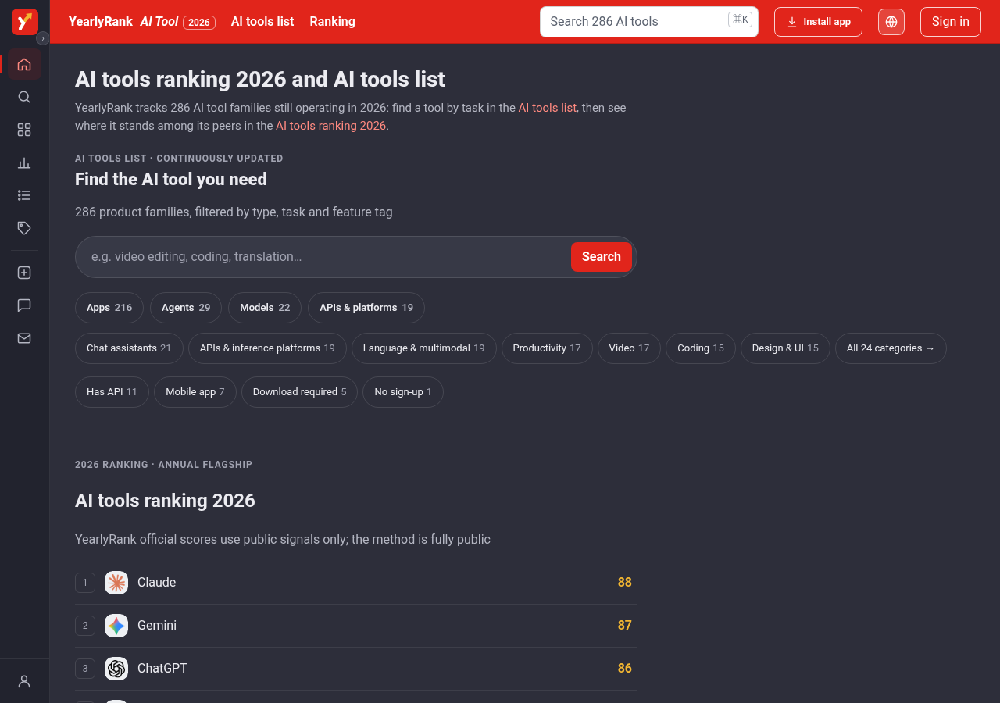
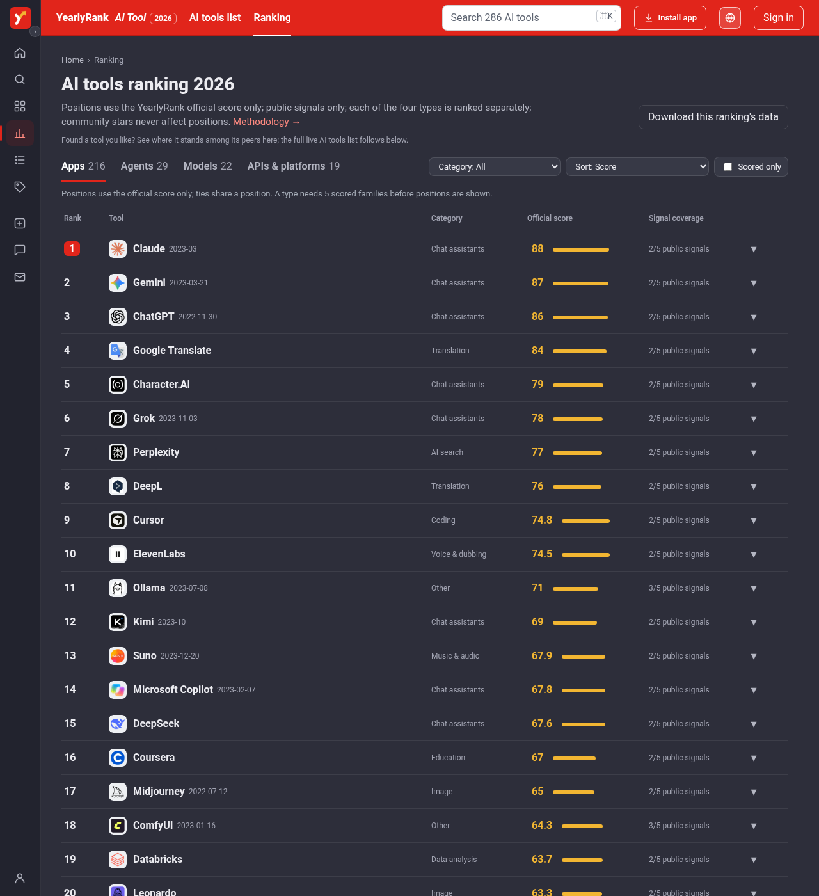
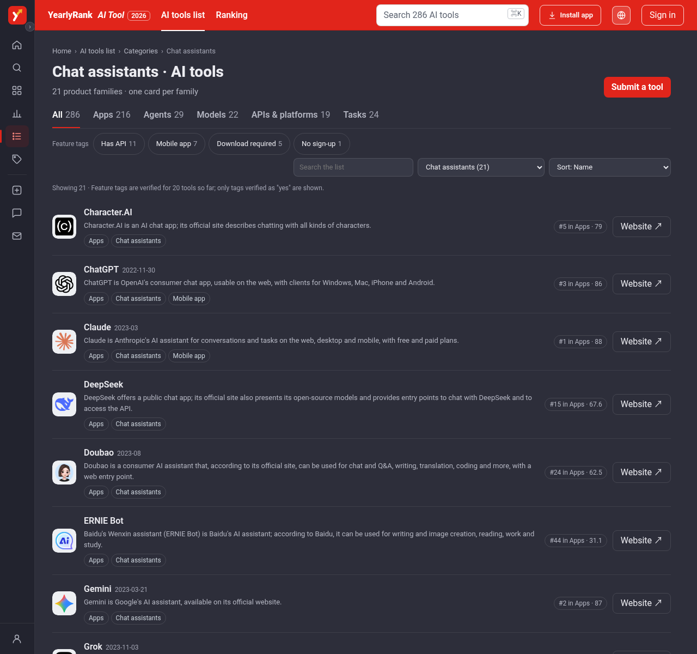
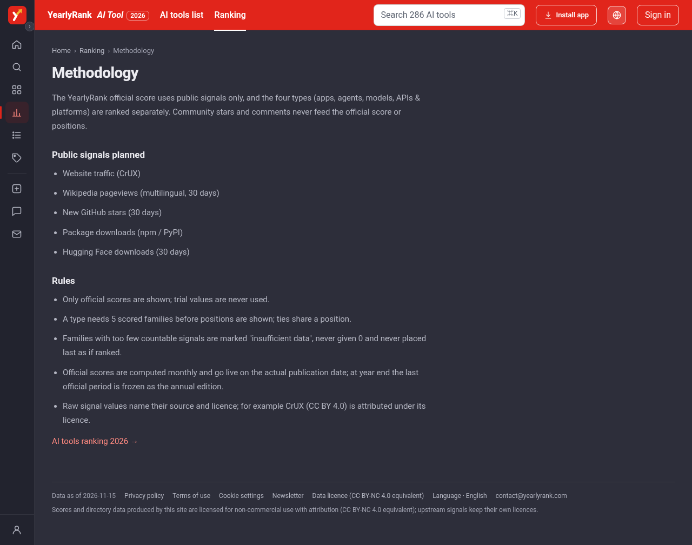
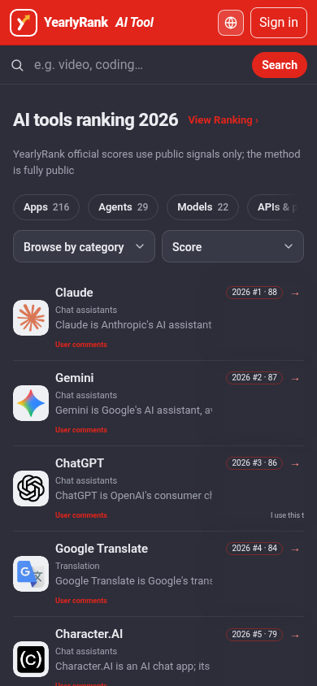

# YearlyRank AI Tool

A directory of AI tool families still operating in 2026, with official scores built from public signals only.

**Live site:** [https://aitool.yearlyrank.com](https://aitool.yearlyrank.com)

This repository is a public description of the site. It is not the production source tree.

## What the site covers

The current edition lists **286 AI tool families** in four types, which are ranked separately:

- Apps: 216
- Agents: 29
- Models: 22
- APIs & platforms: 19

They are organised into **24 task categories** (for example chat assistants, coding, image, and APIs & inference platforms) and a small set of feature tags. The site is published in **30 languages**. English is served at the site root; other languages use a locale prefix (for example /zh-cn/, /de/, /ja/).

Figures above are taken from the live site as of the current edition (the pages show “Data as of 2026-11-15”).

## Official scores

Official scores are published on the live site. They use **public signals only**. Community stars and comments do not feed the official score or positions.

Public signals described on the [methodology page](https://aitool.yearlyrank.com/rank/methodology/):

- Website traffic (CrUX)
- Wikipedia pageviews (multilingual, 30 days)
- New GitHub stars (30 days)
- Package downloads (npm / PyPI)
- Hugging Face downloads (30 days)

Rules stated on that page:

- Only official scores are shown; trial values are never used.
- A type needs 5 scored families before positions are shown; ties share a position.
- Families with too few countable signals are marked “insufficient data”. They are never given a score of 0 and are never placed last as if they had been ranked.
- Official scores are computed monthly and go live on the actual publication date. At year end the last official period is frozen as the annual edition.
- Only the official overall score is published; per-signal values are not published. Signal sources and their licences are listed on the methodology page; for example CrUX (CC BY 4.0) is attributed under its licence.

In the current published edition, of the 286 families:

- 85 have an official score
- 180 are marked insufficient data
- 21 are marked method under review

Methodology: [https://aitool.yearlyrank.com/rank/methodology/](https://aitool.yearlyrank.com/rank/methodology/)

## Ranking pages

Live English pages (other languages use the same paths with a locale prefix):

- [Home](https://aitool.yearlyrank.com/)
- [AI tools ranking 2026](https://aitool.yearlyrank.com/rank/) (positions by official score, each type ranked separately)
- Type rankings: [Apps](https://aitool.yearlyrank.com/rank/app/), [Agents](https://aitool.yearlyrank.com/rank/agent/), [Models](https://aitool.yearlyrank.com/rank/model/), [APIs & platforms](https://aitool.yearlyrank.com/rank/api/)
- [Categories](https://aitool.yearlyrank.com/category/), for example [Chat assistants](https://aitool.yearlyrank.com/category/chat-assistants/)
- [Methodology](https://aitool.yearlyrank.com/rank/methodology/)
- [AI tools list](https://aitool.yearlyrank.com/tools/)

Screenshots of the live site (16 November 2026, Asia/Shanghai):

## Data file

A CSV of the current edition is in [`data/yearlyrank-aitool-scores-2026-11-15.csv`](data/yearlyrank-aitool-scores-2026-11-15.csv). It lists all **286** families, with the official overall score and position within type where the site publishes them, plus the status `scored` (85), `insufficient_data` (180), or `method_under_review` (21). Column definitions, licence, and limits of reproduction are in [`data/README.md`](data/README.md).

The live site also offers the same official totals at [https://aitool.yearlyrank.com/data/rank-2026.csv](https://aitool.yearlyrank.com/data/rank-2026.csv).

Per-signal values are not published, so this file is not a full input dump. The method is public on the [methodology page](https://aitool.yearlyrank.com/rank/methodology/), and the signals come from public sources anyone can query. That is enough to understand and independently query the same kinds of signals; it is not a claim that every per-signal input can be reproduced exactly.

## Languages

The 30 language versions are:

English, Deutsch, Français, 日本語, Nederlands, Español, Svenska, Dansk, Norsk, 한국어, 繁體中文, Italiano, Suomi, Português (Brasil), עברית, Polski, العربية, Čeština, Türkçe, Ελληνικά, Magyar, Română, Bahasa Indonesia, ไทย, Tiếng Việt, 简体中文, Hrvatski, Slovenčina, Български, Slovenščina.

## How to participate

To suggest a new AI tool family, or a correction to an existing listing:

- Open a GitHub issue with the [tool submission template](.github/ISSUE_TEMPLATE/tool-submission.md), or
- Open a pull request that adds a row to [`data/tool-suggestions.md`](data/tool-suggestions.md), or
- Email the same details to [contact@yearlyrank.com](mailto:contact@yearlyrank.com)

Please include the tool name, official website, type (app, agent, model, or api), a suggested category, and official-source links for the launch date and that the product is still operating in 2026.

The site lists families that are still operating in 2026, with facts checked against verified official sources. Every suggestion is reviewed by a person. Listing is not guaranteed, and neither is a place in the ranking or a score.

Submissions do not change official scores. Scores come only from public signals, as described in the methodology.

See [CONTRIBUTING.md](CONTRIBUTING.md) for the full notes.

## Licence

Scores and directory data produced by the site are licensed for non-commercial use with attribution (CC BY-NC 4.0 equivalent). Upstream signals keep their own licences.

See the site footer and [https://aitool.yearlyrank.com/rank/methodology/](https://aitool.yearlyrank.com/rank/methodology/).

## Contact

The site lists [contact@yearlyrank.com](mailto:contact@yearlyrank.com).
